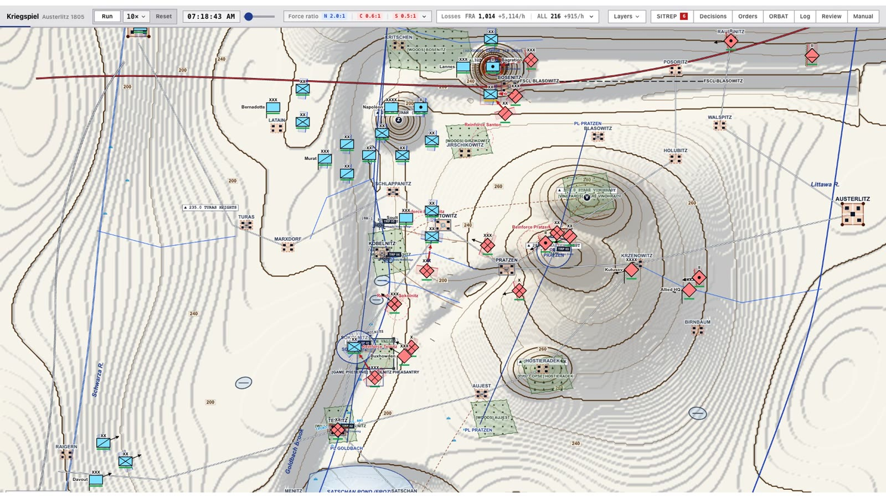
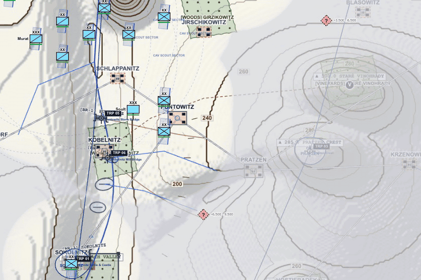
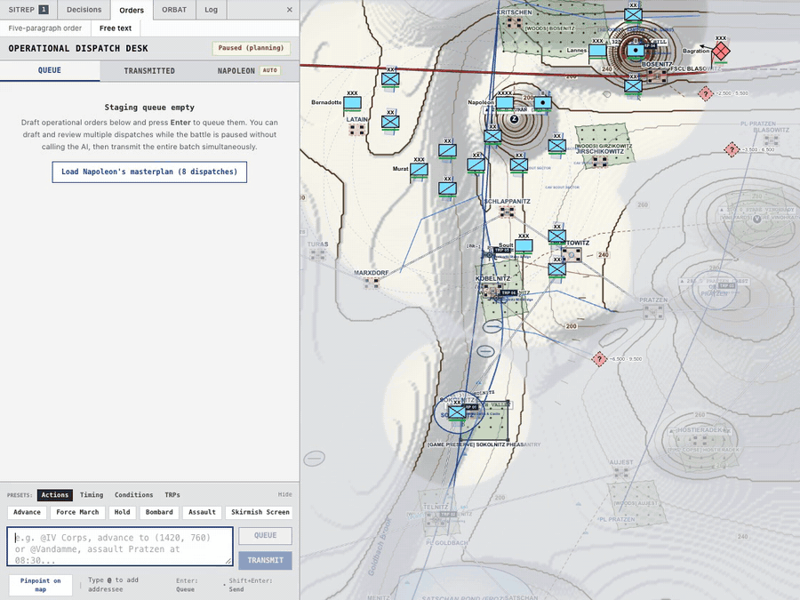
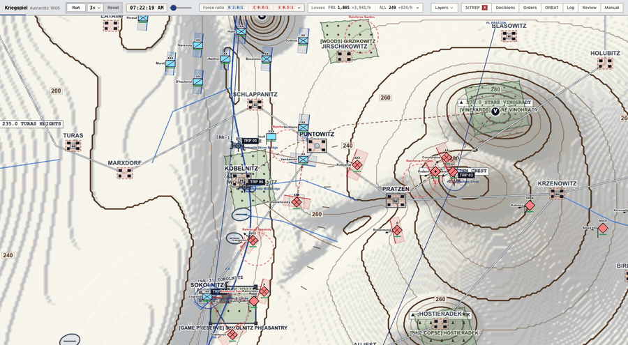
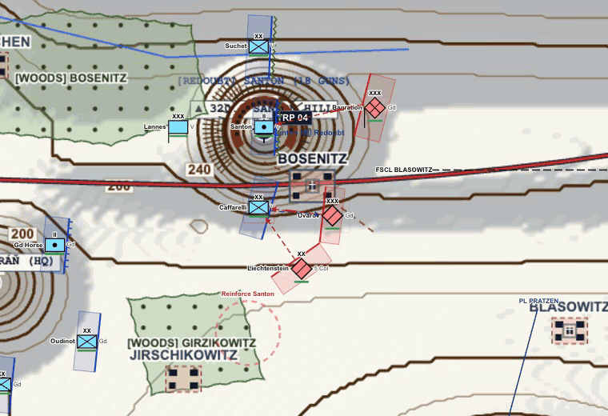
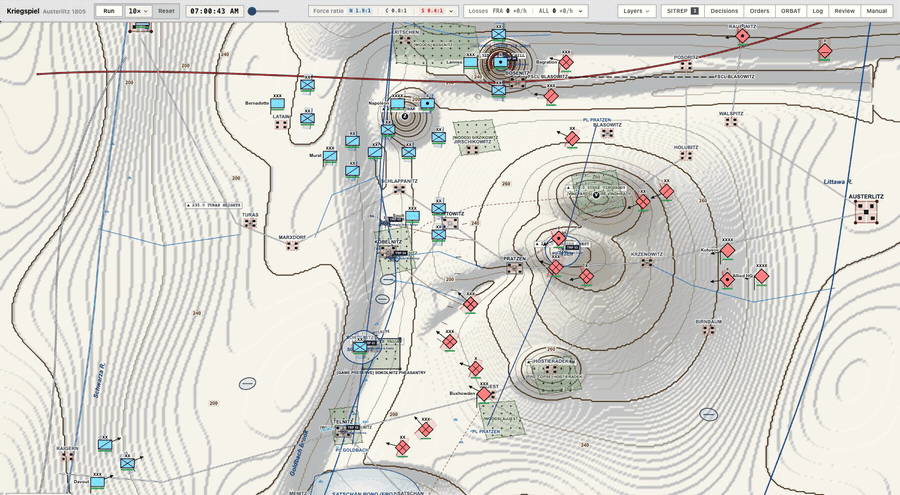
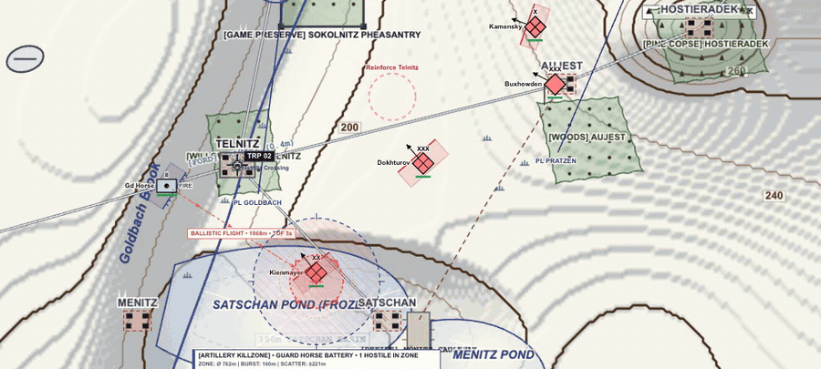
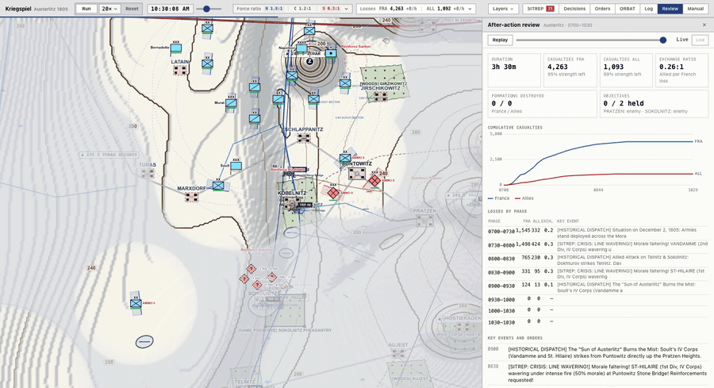

# Kriegsspiel — Austerlitz 1805

A real-time command-and-control wargame of the Battle of Austerlitz that runs in the browser. You play Napoleon's staff, not his soldiers: you send orders by courier, they arrive late, your picture of the enemy goes out of date, and the map looks like a modern NATO operations overlay laid on a topographic atlas.

[](docs/media/kriegspiel-montage.mp4)

<sub>▶ Click the image to watch the 46-second montage.</sub>

## The battle

You command the French from 07:00 to 16:00 on 2 December 1805. The briefing follows history. Davout holds the Allied left along the Goldbach stream, and Soult's IV Corps climbs the Pratzen Heights once the Allied centre has thinned. The game doesn't declare a winner. When the clock runs out, an after-action review grades each objective (held, enemy, contested or unoccupied) and shows casualties and the exchange ratio.

## Giving orders

Draw an order on the map, or type it the way a staff officer would write a dispatch.

| Drag-line orders | Free-text dispatches |
| --- | --- |
|  |  |
| Right-click and drag to draw a movement or formation line. Q and E bend it into an arc, and R straightens it again. Right-click an enemy unit to attack or bombard it. | Type an order such as *"@Vandamme advance on Pratzen in column, forced march"*. A local LLM running in [Ollama](https://ollama.com) parses it. If Ollama isn't running, a rule-based parser handles it instead. |

Every order goes out by courier. Delivery time depends on how far the unit is from headquarters, and an urgent courier gets there in half the time. Until the courier arrives the order shows as *delivering*. The unit then acknowledges with WILCO, or waits for a start time you've set.

## Combat

| Infantry firefight | Rout at the Santon |
| --- | --- |
|  |  |
| **Allied advance** | **Bombardment on the frozen ponds** |
|  |  |

- **Morale.** Casualties shake morale, and so do fire from the flank, the rear and enfilade. Units recover slowly once out of contact, rally above 40% morale, and fall back when they rout.
- **Formations.** Units fight in line, column or square, each trading speed against firepower. Column is fastest and square is slowest. Artillery does extra damage to columns.
- **Artillery.** Batteries can bombard a target, fire on registered target reference points (TRPs) or fire at enemy batteries. Massed grand batteries break down the cover of strongpoints, and counter-battery hits can blow up ammunition wagons.
- **Terrain.** Villages, woods and high ground give cover, though it counts for less in melee. Morning mist in the valleys shortens how far units can see.

## Fog of war

Enemy units close enough to your forces are *identified*. Units further out show only as *contacts*. When a unit drops out of sight, a last-known marker stays where it was last seen and fades over 90 minutes. A referee toggle shows the whole battlefield.

## After-action review



The review plots casualties over time, breaks losses down by 30-minute phase, lists the key events, and replays the whole battle on the map.

## Running it

Requires Node 18 or later.

```bash
npm install
npm run dev
```

Then open the URL Vite prints, which is http://localhost:5175.

**Optional: LLM dispatch parsing.** Install [Ollama](https://ollama.com) and pull a small model. The game looks for Ollama at `http://localhost:11434` and uses `gemma4:e2b` by default:

```bash
ollama pull gemma4:e2b
```

If Ollama isn't running, the game switches to its rule-based parser without any setup.

## Controls

| Key | Action |
| --- | --- |
| Space | Pause / resume |
| WASD or arrow keys | Pan the map |
| Right-click drag | Draw a move or formation order (Q/E bend the line, R resets it) |
| Right-click a unit | Attack or bombard (enemy unit) / context menu |
| F | Charge the nearest enemy (infantry and cavalry) |
| B | Bombard targeting for the selected artillery |
| M | Bearing tool |
| R / C / K / T | Range rings / corps overlay / artillery kill zones / topography |
| G | Hex grid |
| X / Shift+X | Copy coordinates / with bearing |
| `` ` `` or Alt+D | Dispatch rail |
| Shift+C | Cinematic mode |
| Esc | Cancel / deselect |

## Project layout

```
src/
  engine/       simulation, AI, canvas renderer, APP-6 symbology, replay, sound
  components/   HUD, dispatch desk, order composer, context menu, AAR, order of battle
  services/     LLM dispatch parser (Ollama) with rule-based fallback
  data/         Austerlitz scenario: terrain, objectives, order of battle, briefing
  types/        shared game types
```

Built with React 19, TypeScript, Vite and Tailwind. All rendering is done on a single HTML canvas, and the sound effects are synthesized with the Web Audio API (muted by default).

## License

[MIT](LICENSE)
